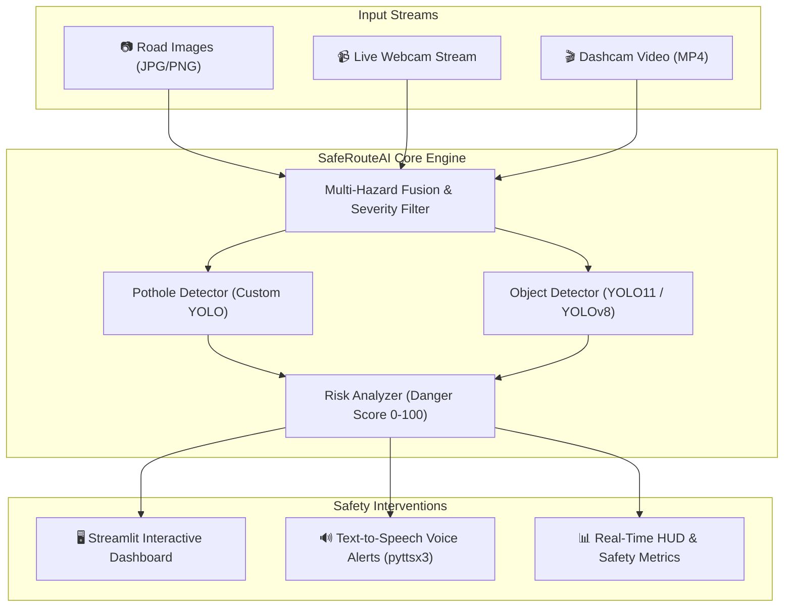

# 🚗 SafeRouteAI: Intelligent Road Hazard Monitoring & Safety Assistance

[](https://www.python.org/)
[](https://docs.ultralytics.com/)
[](https://streamlit.io/)
[](LICENSE)

**SafeRouteAI** is an advanced, computer-vision-driven road hazard detection and proactive driver assistance system. By fusing custom-trained deep learning models with real-time risk assessment and voice warnings, SafeRouteAI detects roadway hazards—such as potholes, pedestrians, surrounding vehicles, and animals—helping prevent collisions and vehicle damage before they occur.

---

## 📌 System Architecture



---

## ✨ Key Features

1. **Precision Pothole Detection**: Custom-trained convolutional YOLO model identifying road surface depressions, categorized into Low, Medium, and High severity based on size and proximity.
2. **Multi-Hazard Awareness**: Tracks pedestrians, oncoming vehicles (cars, motorcycles, buses, trucks, ambulances), and animals simultaneously.
3. **Dynamic Risk Scoring**: Synthesizes hazard frequency, confidence levels, and bounding box area ratios into an intuitive risk rating (`SAFE`, `LOW`, `MEDIUM`, `HIGH`, `CRITICAL`).
4. **Hands-Free Auditory Warnings**: Integrated text-to-speech alerting system delivering low-latency audio instructions (*"Deep pothole detected. Brake gently and avoid it"*).
5. **Interactive Web Dashboard**: Streamlit-powered inspection suite supporting image uploads, sample test catalogs, live webcam snapshots, and video playback.
6. **Unified Hub Launcher**: Interactive CLI control center (`launch.py`) and Windows executable batch script (`run.bat`) for quick access across all runtime modes.

---

## 📊 Model Performance & Benchmarks

Evaluated on the validation split with standard IoU thresholds:

| Metric | Pothole Model Score |
| :--- | :--- |
| **Precision (P)** | **76.8%** |
| **Recall (R)** | **60.4%** |
| **mAP@0.50** | **64.7%** |
| **mAP@0.50:0.95** | **36.1%** |
| **Inference Latency** | **~162 ms / frame (CPU)** |
| **Model Footprint** | ~3.0M Parameters (8.1 GFLOPs) |

---

## 📂 Project Structure

```text
SafeRouteAI/
├── app.py                     # Streamlit web dashboard
├── detectors.py               # Unified MultiHazardDetector, PotholeDetector, PersonDetector
├── risk_analyzer.py           # Multi-hazard risk evaluation & prompt engine
├── alert_manager.py           # Audio TTS alert system with pyttsx3
├── evaluate.py                # Model validation and benchmark evaluation script
├── launch.py                  # Interactive CLI system launcher
├── run.bat                    # 1-Click Windows execution script
├── road_safety.py             # Live webcam real-time hazard detection loop
├── final_demo.py              # Video stream demonstration with HUD overlay
├── test.jpg                   # Default test road scene
├── road_video.mp4             # Dashcam sample video
├── requirements.txt           # Python package requirements
├── data.yaml                  # YOLO dataset configuration
│
├── ai/
│   ├── train.py               # Configurable YOLO training & fine-tuning script
│   └── data.yaml              # Multi-class dataset specification
│
├── dataset/                   # Pothole training and validation images/labels
├── dataset_multi/             # Multi-hazard vehicle and person datasets
└── runs/detect/               # Checkpoints, validation curves, and detection logs
```

---

## 🚀 Getting Started

### 1. Prerequisites
Ensure you have Python 3.10+ installed.

### 2. Environment Setup

```powershell
# Clone the repository and enter the directory
git clone https://github.com/your-username/SafeRouteAI.git
cd SafeRouteAI

# Create and activate virtual environment
python -m venv .venv
.\.venv\Scripts\Activate.ps1

# Install dependencies
pip install -r requirements.txt
```

---

## 💻 How to Run

### Option A: SafeRouteAI System Hub (Recommended)
Launch the interactive menu:
```powershell
python launch.py
```
*(Or simply double-click `run.bat` on Windows)*

### Option B: Streamlit Web Dashboard
Run the web application directly in your browser:
```powershell
streamlit run app.py
```
Open [http://localhost:8501](http://localhost:8501) to explore uploaded images, sample test scenes, live camera captures, and visual hazard maps.

### Option C: Live Webcam Detection
Connect a webcam and run real-time hazard tracking:
```powershell
python road_safety.py
```
*(Press `Q` to quit)*

### Option D: Dashcam Video Demo
Process recorded road video with AI overlays and sound alerts:
```powershell
python final_demo.py
```

### Option E: Model Evaluation & Validation
Evaluate the current best weights against dataset splits:
```powershell
python evaluate.py --model runs/detect/pothole_detection-4/weights/best.pt --data data.yaml
```

### Option F: Fine-Tuning & Model Training
Train a new YOLO model on custom datasets:
```powershell
python ai/train.py --data data.yaml --model yolov8n.pt --epochs 50 --batch 8
```

---

## 🛡️ License
Distributed under the MIT License. See `LICENSE` for details.